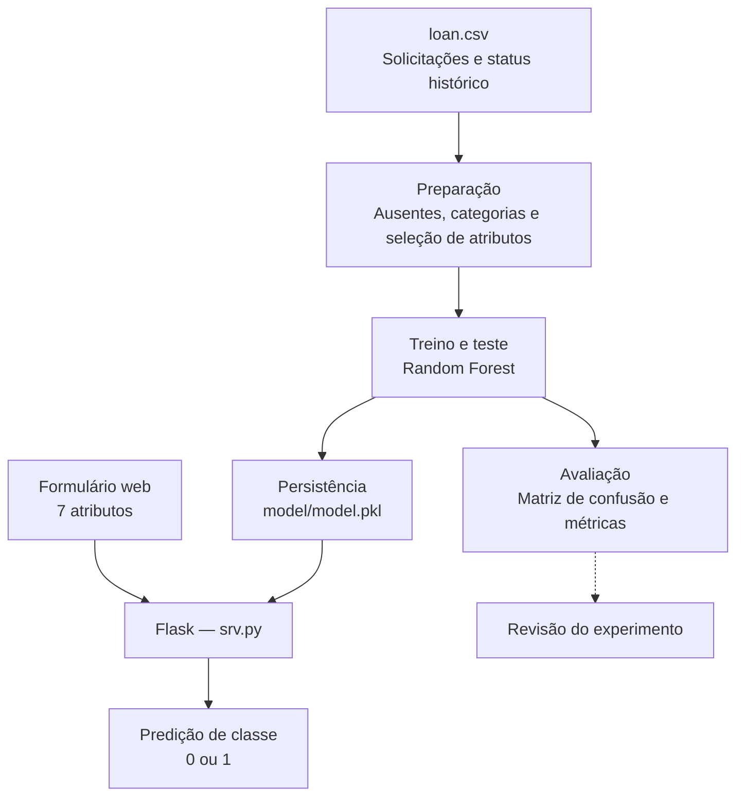

<div align="center">

# 💳 Análise de Crédito — Empréstimo
### Classificação supervisionada · Random Forest · Flask

**Um estudo do caminho entre uma base histórica e uma aplicação de Machine Learning.**

Preparação dos dados, treinamento de um classificador, avaliação e integração com um formulário web.

[Notebook](An%C3%A1lise%20de%20Cr%C3%A9dito.ipynb) · [Dados](loan.csv) · [Aplicação](srv.py) · [Resultados](#resultados-registrados) · [Execução](#como-explorar-e-executar)

</div>

---

| **614 registros** | **7 variáveis de entrada** | **100 árvores** |
| --- | --- | --- |
| Base disponível em loan.csv. | Atributos selecionados no notebook. | Configuração da Random Forest. |

## O problema e o objetivo do estudo

O projeto explora a classificação de solicitações de empréstimo a partir de dados históricos. O objetivo didático é acompanhar as etapas de um projeto de Machine Learning e disponibilizar a predição em uma interface Flask.

A variável-alvo é **Loan_Status**, com as classes **Y — aprovado** e **N — negado**. O modelo aprende padrões desses rótulos históricos.

**Aprovação não é o mesmo que pagamento.** A base deste estudo não apresenta um desfecho de inadimplência que permita interpretar a saída como “probabilidade de pagar”. Trata-se de uma demonstração acadêmica, não de uma política validada de concessão de crédito.

## Como o projeto funciona



O notebook reúne o experimento. A aplicação carrega um modelo persistido e recebe os campos enviados pelo formulário; não treina o modelo a cada consulta.

## Dados e preparação

O arquivo [loan.csv](loan.csv) contém **614 linhas e 13 colunas**.

| Rótulo original | Registros | Codificação |
| --- | ---: | ---: |
| **Y — aprovado** | 422 | 1 |
| **N — negado** | 192 | 0 |

### Etapas descritas no notebook

| Etapa | Abordagem utilizada |
| --- | --- |
| **Balanceamento** | Seleção de 200 registros Y e 192 registros N, totalizando 392 no trecho correspondente. |
| **Valores ausentes** | Preenchimentos categóricos definidos no código e médias para valores numéricos como LoanAmount. |
| **Categorias** | Mapeamento manual para códigos numéricos. |
| **Seleção de atributos** | Remoção de Loan_ID, CoapplicantIncome, Loan_Amount_Term, Credit_History e Property_Area. |
| **Divisão** | 20% para teste, com random_state=42. |
| **Modelo** | RandomForestClassifier com n_estimators=100 e min_samples_split=2. |

A seleção de atributos é uma escolha do exemplo; a remoção de uma coluna não comprova que ela seja irrelevante em outros cenários.

## Entradas do modelo

A ordem usada no treino e em srv.py é:

```text
Gender → Married → Dependents → Education
       → Self_Employed → ApplicantIncome → LoanAmount
```

| Atributo | Significado | Codificação do treino |
| --- | --- | --- |
| **Gender** | Sexo registrado na base | Female = 0; Male = 1 |
| **Married** | Estado civil no cadastro | No = 0; Yes = 1 |
| **Dependents** | Quantidade de dependentes | 0, 1, 2 ou 3, sendo 3 a representação de “3+” |
| **Education** | Escolaridade | Graduate = 0; Not Graduate = 1 |
| **Self_Employed** | Trabalho por conta própria | No = 0; Yes = 1 |
| **ApplicantIncome** | Rendimento do solicitante | Valor numérico na escala da fonte |
| **LoanAmount** | Valor do empréstimo | Valor numérico na escala da fonte |

A escala e a unidade dos campos monetários precisam ser confirmadas na documentação da fonte; não assuma que rendimento e empréstimo usam a mesma unidade ou valores em reais.

**Ponto de integração:** o formulário atual inverte os códigos de Education em relação ao treino. Antes de interpretar uma predição da interface, alinhe essa codificação e valide os campos de entrada.

## Resultados registrados

O notebook contém a matriz abaixo em suas saídas salvas. Esses resultados são **históricos** e não foram recalculados nesta revisão.

| Classe real | Predito N — 0 | Predito Y — 1 | Total |
| --- | ---: | ---: | ---: |
| **N — 0** | 6 | 37 | 43 |
| **Y — 1** | 8 | 72 | 80 |
| **Total** | 14 | 109 | 123 |

| Medida derivada dessa saída | Valor aproximado |
| --- | ---: |
| **Acurácia** | 63,4% |
| **Recall de N** | 14,0% |
| **Recall de Y** | 90,0% |
| **F1 macro** | 0,49 |

O modelo reconhece muito mais casos Y do que N nesse registro. Prever sempre Y nesse mesmo teste acertaria 80 de 123 casos, aproximadamente **65,0%**. Isso mostra por que comparar com um baseline e olhar métricas por classe é importante.

### Um cuidado com a sequência das saídas

O código de balanceamento indica 392 registros, enquanto a matriz salva tem 123 casos de teste — quantidade compatível com 20% da base original de 614, não com 20% de 392.

Portanto, **as saídas não demonstram uma execução única e consistente de todas as células em ordem**. Reexecute o notebook desde o início e registre o ambiente antes de apresentar uma nova avaliação.

<details>
<summary><strong>Outros pontos para uma nova avaliação</strong></summary>

<br>

- As amostragens de balanceamento e a Random Forest não têm random_state definido.
- O tratamento de ausentes e o balanceamento aparecem antes da divisão. Em uma nova avaliação, ajuste as transformações aprendidas e o reamostramento apenas no treino.
- Utilize divisão apropriada, estratificação quando aplicável e um conjunto de teste preservado.
- Avalie erros por classe, estabilidade e possíveis efeitos dos atributos utilizados, incluindo sexo e estado civil.
- A saída de predict_proba precisa ser lida na ordem de model.classes_. Com classes [0, 1], [0.56, 0.44] corresponde a N e Y nessa ordem; não significa 56% de chance de pagamento.

</details>

## Aplicação Flask

| Rota | Comportamento |
| --- | --- |
| **GET /** | Renderiza o formulário. |
| **POST /verificar** | Recebe os sete atributos, chama model.predict e devolve a classe ao template. |

O serviço carrega [model/model.pkl](model/model.pkl) ao iniciar e utiliza a porta **5500** por padrão, ou o valor da variável de ambiente PORT.

O uso de Flask aqui é uma demonstração local. O comando de desenvolvimento não representa, sozinho, uma implantação operacional.

## Arquivos do projeto

| Arquivo ou pasta | Função |
| --- | --- |
| [**Análise de Crédito.ipynb**](An%C3%A1lise%20de%20Cr%C3%A9dito.ipynb) | Preparação, treino, métricas e persistência. |
| [**loan.csv**](loan.csv) | Base de solicitações e rótulos. |
| [**srv.py**](srv.py) | Aplicação Flask e inferência. |
| [**model/model.pkl**](model/model.pkl) | Modelo serializado disponível no repositório. |
| [**templates/template.html**](templates/template.html) | Formulário e apresentação do resultado. |
| [**static/**](static/) | Imagens e arquivos auxiliares da interface. |

## Como explorar e executar

### 1. Conheça o experimento

Abra o [notebook no GitHub](An%C3%A1lise%20de%20Cr%C3%A9dito.ipynb). Consulte os dados, o mapeamento das categorias e as saídas com os cuidados descritos acima.

Para uma execução local, trabalhe a partir desta pasta, mantendo loan.csv, model/, templates/ e static/ nos caminhos esperados.

### 2. Prepare as dependências e a compatibilidade

O projeto utiliza Python, NumPy, pandas, scikit-learn, joblib, Flask e um ambiente de notebook. Não há um arquivo de dependências com versões fixadas nesta pasta.

O material é histórico e requer ajustes para bibliotecas atuais:

| Trecho | Ajuste a considerar |
| --- | --- |
| **from sklearn.externals import joblib** | Usar import joblib, com o pacote instalado. |
| **DataFrame.append** | Substituir por pd.concat, preservando a lógica pretendida. |
| **Modelo serializado antigo** | Verificar o ambiente de origem; preferir retreinar e salvar no mesmo ambiente usado para servir. |
| **Caminho model.pkl no notebook** | Unificar com model/model.pkl, utilizado pela aplicação. |
| **Education no formulário** | Alinhar os valores aos códigos da tabela de entradas. |
| **Campos recebidos pelo Flask** | Converter e validar tipos, valores permitidos e escala antes da predição. |

A [documentação de persistência do scikit-learn](https://scikit-learn.org/stable/model_persistence.html) explica as limitações de carregar estimadores entre versões. Use apenas artefatos serializados de origem confiável.

### 3. Treine, confira e salve

Execute o notebook em ordem após os ajustes. Confira os tamanhos das amostras, as classes, a ordem das features e os resultados.

Se gerar um novo modelo, salve-o em model/model.pkl e valide uma entrada diretamente no Python antes de testar o mesmo caso no formulário.

### 4. Inicie a demonstração local

Após resolver os pontos de compatibilidade e alinhar os campos:

```bash
python srv.py
```

Acesse [http://localhost:5500](http://localhost:5500), caso mantenha a porta padrão.


## Possibilidades de evolução

- Criar um Pipeline de preparação e classificação persistido como unidade.
- Fixar versões e sementes e reexecutar a avaliação.
- Adicionar validação de entradas e testes de equivalência entre notebook e formulário.
- Comparar com um baseline e outros classificadores.
- Revisar as variáveis utilizadas e avaliar limitações e vieses.
- Documentar a origem, as unidades e o significado do alvo.
- Preparar um ambiente reproduzível de execução.

## Referências

- [RandomForestClassifier — scikit-learn](https://scikit-learn.org/stable/modules/generated/sklearn.ensemble.RandomForestClassifier.html).
- [Persistência de modelos — scikit-learn](https://scikit-learn.org/stable/model_persistence.html).
- [Flask — guia oficial](https://flask.palletsprojects.com/en/stable/quickstart/).

O notebook registra a versão v1.0 do estudo em **16/02/2020** e suas referências originais. Consulte-o para acompanhar o contexto do material.

---

**Alex Souza — liderança em dados e professor**

[Portfólio](https://omestredosdados.com.br/portfolio) · [Telegram — Mestre dos Dados](https://t.me/mestredosdados) · [Blog](https://medium.com/blog-do-zouza)
