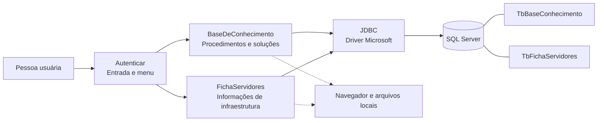

<div align="center">

# 📚 Base de Conhecimento
### Conhecimento documentado para apoiar equipes de TI e negócios

**Transformar soluções do dia a dia em informação que pode ser consultada e reutilizada.**

Aplicação desktop em **Java Swing**, com persistência em **SQL Server** via **JDBC**.

[Funcionalidades](#funcionalidades) · [Arquitetura](#arquitetura) · [Execução](#como-executar) · [Artigo e manual](https://blogdozouza.wordpress.com/2020/03/02/construindo-um-sistema-de-base-de-conhecimento-para-sua-ti/)

</div>

---

## Por que este projeto existe?

Procedimentos, soluções de incidentes e informações sobre servidores precisam estar acessíveis para quem atende uma demanda. Quando esse conhecimento fica disperso, consultar uma solução depende de encontrar a pessoa ou o arquivo certo.

Este projeto propõe uma base simples para **registrar, organizar e pesquisar conhecimento**, apoiando equipes de suporte, infraestrutura e negócios. Reúne cadastro de procedimentos e fichas de servidores em uma interface desktop.

O material preserva uma implementação histórica, identificada na tela “Sobre” como **versão 2020.1**. É uma referência prática para estudar interfaces Java, operações de cadastro e integração com banco de dados.

## Funcionalidades

| Recurso | O que o código oferece |
| --- | --- |
| **Base de conhecimento** | Cadastro de título, descrição, solução, observações e referências. |
| **Ficha de servidores** | Registro de descrição, informações complementares e referências de infraestrutura. |
| **Organização dos registros** | Classificação por núcleo, categoria, produto, autor e situação ativa. |
| **Manutenção** | Inclusão, alteração e exclusão de registros. |
| **Consulta** | Pesquisa por código ou texto, além da navegação entre registros. |
| **Acesso a referências** | Abertura de links no navegador e de arquivos ou caminhos locais. |
| **Entrada no sistema** | Tela de autenticação demonstrativa antes do menu principal. |

As opções de núcleos, categorias, produtos e autores estão definidas nos arquivos Java; não são cadastros administráveis pela interface.

## Arquitetura



A interface Swing executa as consultas diretamente por JDBC. As configurações de conexão estão nos métodos `ConeccaoDB()` das duas classes de cadastro.

## O que fica registrado?

| Grupo | Campos |
| --- | --- |
| **Identificação e classificação** | Código, categoria, produto, núcleo e título. |
| **Conteúdo** | Descrição e solução na base de conhecimento; descrição e informações na ficha de servidores. |
| **Contexto do registro** | Observações, indicador de ativo, autor e data. |
| **Referências** | Link e caminho para arquivo ou pasta. |

O [script SQL](Banco%20de%20Dados/MontagemAmbienteDeBancoDeDados.sql) cria duas tabelas:

- **TbBaseConhecimento:** procedimentos e soluções, com o campo `Solucao`.
- **TbFichaServidores:** informações de servidores, com o campo `Info`.

Em ambas, `Codigo` é gerado por `IDENTITY(1,1)`. O script não declara uma chave primária nem relacionamento entre as tabelas.

## Explore os arquivos

| Arquivo ou pasta | Finalidade |
| --- | --- |
| [**src/Autenticar.java**](src/Autenticar.java) | Ponto de entrada, autenticação demonstrativa e menu principal. |
| [**src/BaseDeConhecimento.java**](src/BaseDeConhecimento.java) | Interface e operações da base de conhecimento. |
| [**src/FichaServidores.java**](src/FichaServidores.java) | Interface e operações das fichas de servidores. |
| [**src/Sobre.java**](src/Sobre.java) | Informações sobre autoria e versão. |
| [**Banco de Dados/**](Banco%20de%20Dados/) | Script de criação das tabelas e driver JDBC `sqljdbc42.jar`. |
| [**SistemasTI_2020.jar**](SistemasTI_2020.jar) | Pacote Java já compilado disponível no repositório. |
| [**bin/**](bin/) | Classes compiladas incluídas no material original. |

Os arquivos `1.ico`, `Abrir.jpg` e `EduTECHBrasil.jpg` também estão disponíveis nesta pasta. O código faz referência a recursos visuais por caminhos relativos.

## Como executar

### 1. Prepare o ambiente

Você precisará de:

- **JDK** para compilar os fontes e executar Java.
- **SQL Server** acessível pela máquina da aplicação.
- **Driver JDBC compatível** com as versões de Java e SQL Server utilizadas.
- Um ambiente com **interface gráfica**, pois a aplicação utiliza Swing e AWT.

O repositório inclui `sqljdbc42.jar`, mas não fixa uma matriz de versões suportadas nem fornece configuração Maven ou Gradle. Confira a [compatibilidade do driver JDBC da Microsoft](https://learn.microsoft.com/sql/connect/jdbc/system-requirements-for-the-jdbc-driver) antes de montar o ambiente.

### 2. Crie as tabelas

No SQL Server:

1. Crie ou escolha um banco de testes.
2. Abra [MontagemAmbienteDeBancoDeDados.sql](Banco%20de%20Dados/MontagemAmbienteDeBancoDeDados.sql).
3. Substitua `USE [SeuBancoAqui]` pelo nome do banco escolhido.
4. Execute o script nesse banco para criar as duas tabelas.

A criação do banco e do usuário de conexão não faz parte do script.

### 3. Configure a conexão

Edite `ConeccaoDB()` em **BaseDeConhecimento.java** e **FichaServidores.java**. Ajuste servidor, porta, banco e autenticação para o seu ambiente.

O endereço presente nos fontes é um exemplo. Prefira configuração externa para as credenciais e um usuário de banco com apenas as permissões necessárias à aplicação.

**Antes de testar a pesquisa textual:** em `BaseDeConhecimento.java`, a consulta faz referência a `Solução`, enquanto o script cria a coluna `Solucao`. Alinhe esse nome na consulta para corresponder ao esquema.

### 4. Compile e inicie

Abra um terminal **nesta pasta** (`BaseConhecimento`), para preservar os caminhos relativos dos recursos. Os comandos abaixo usam o driver incluído; adapte o caminho se utilizar outra versão.

```bash
mkdir build
javac -encoding UTF-8 -cp "Banco de Dados/sqljdbc42.jar" -d build src/*.java
```

**Windows:**

```bat
java -cp "build;Banco de Dados/sqljdbc42.jar" Autenticar
```

**Linux ou macOS:**

```bash
java -cp "build:Banco de Dados/sqljdbc42.jar" Autenticar
```

Se o compilador indicar problemas com caracteres acentuados, confirme a codificação dos arquivos no editor e ajuste a opção `-encoding` de acordo com os fontes locais.

A tela de entrada usa valores demonstrativos definidos em `Autenticar.java`. Ela não consulta uma tabela de usuários.

> Alterações nos fontes exigem recompilação. Abrir o JAR ou as classes antigas não aplica automaticamente as mudanças feitas em `src/`. Os comandos são uma orientação de preparação; a execução com um SQL Server não foi validada nesta revisão do README.

## Roteiro para explorar a aplicação

1. Entre pelo menu principal e abra **Cadastro → Base de Conhecimento**.
2. Use **Novo** para preparar um registro e **Adiciona** para gravá-lo.
3. Preencha título, contexto do problema, solução e referências úteis.
4. Consulte o registro por código e teste a pesquisa textual após o ajuste indicado acima.
5. Explore **Ficha de Servidores** para documentar informações de infraestrutura.
6. Confira a abertura de links e arquivos usando referências acessíveis na sua máquina.

**Exemplo de conteúdo:** um procedimento de diagnóstico de falha de conexão pode registrar o sistema afetado, os sintomas, as verificações realizadas, a solução e o link para a documentação técnica.

## Aprendizados e evolução

O projeto permite estudar **eventos em Swing**, **operações CRUD**, **consultas SQL**, **conexões JDBC** e **organização de conhecimento operacional**.

Para evoluir a implementação:

| Frente | Próximo passo |
| --- | --- |
| **Consultas** | Substituir SQL montado por concatenação por `PreparedStatement`, inclusive nas pesquisas. |
| **Acesso** | Substituir a autenticação fixa por gestão de usuários e permissões. |
| **Configuração** | Externalizar conexão e listas hoje definidas nos fontes. |
| **Estrutura** | Separar interface, regras e acesso a dados. |
| **Banco** | Definir chaves, restrições e regras de validação. |
| **Manutenção** | Adotar gerenciamento de dependências e verificar o uso de APIs antigas. |
| **Qualidade do conteúdo** | Definir responsáveis, revisão periódica e critérios para manter procedimentos ativos. |

Essas são possibilidades de evolução; não representam funcionalidades já implementadas.

## Leitura e documentação

- [**Artigo original e breve manual**](https://blogdozouza.wordpress.com/2020/03/02/construindo-um-sistema-de-base-de-conhecimento-para-sua-ti/) — contexto de construção do sistema.
- [**Java Swing — tutorial da Oracle**](https://docs.oracle.com/javase/tutorial/uiswing/) — componentes e interfaces desktop.
- [**Driver JDBC para SQL Server**](https://learn.microsoft.com/sql/connect/jdbc/overview-of-the-jdbc-driver) — documentação oficial da integração.
- [**Prepared Statements em Java**](https://docs.oracle.com/javase/tutorial/jdbc/basics/prepared.html) — referência para evoluir o acesso a dados.

---

**Alex Souza — liderança em dados e professor**

[Portfólio](https://omestredosdados.com.br/portfolio) · [Telegram — Mestre dos Dados](https://t.me/mestredosdados) · [O Mestre dos Dados](https://omestredosdados.com.br/)

[← Voltar ao portfólio no GitHub](../README.md)
