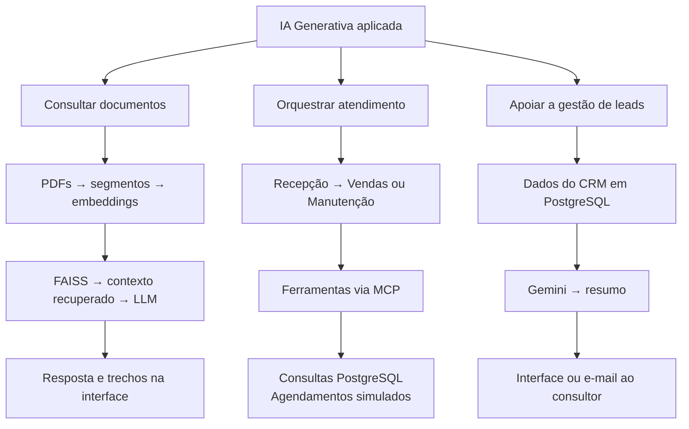

<div align="center">

# ✨ IA Generativa
### Documentos, agentes e aplicações conectadas ao negócio

**Explorando como transformar contexto e dados em respostas, interações e apoio ao trabalho.**

Projetos e estudos práticos de **RAG**, **sistemas multiagente**, **MCP** e **integração de modelos de linguagem com aplicações**.

[Projetos](#projetos-disponíveis) · [Conceitos](#conceitos-na-prática) · [Por onde começar](#por-onde-começar) · [Referências](#referências-para-aprofundar)

</div>

---

## O que você encontra aqui

Esta pasta reúne experiências de IA Generativa aplicadas a três desafios: **consultar documentos**, **orquestrar atendimento** e **produzir resumos a partir de dados de negócio**.

O foco está na integração: como fornecer contexto ao modelo, conectar ferramentas e apresentar o resultado em uma interface útil. Os materiais incluem código Python, documentação das soluções e imagens dos fluxos.

| Frente | Pergunta que orienta o estudo |
| --- | --- |
| **Conhecimento em documentos** | Como consultar PDFs em linguagem natural e inspecionar os trechos utilizados? |
| **Atendimento com agentes** | Como distribuir uma conversa entre agentes especializados e ferramentas de consulta? |
| **IA em processos de negócio** | Como incorporar resumos gerados por IA à rotina de um CRM? |

## Projetos disponíveis

### 📚 1. Converse com documentos — RAG + LangChain

**Consulta conversacional a arquivos PDF**, com recuperação de trechos para contextualizar as respostas.

O código combina extração de texto, divisão em segmentos, embeddings, índice vetorial FAISS e uma interface de chat em Streamlit. O histórico da conversa é utilizado na reformulação das perguntas, e os trechos recuperados podem ser inspecionados na interface.

| Elemento | Implementação presente |
| --- | --- |
| **Documentos** | Upload de um ou mais PDFs e leitura com PyPDFLoader. |
| **Segmentação** | RecursiveCharacterTextSplitter, com segmentos de 1.000 caracteres e sobreposição de 200. |
| **Busca** | FAISS com recuperação por MMR. |
| **Geração** | Integrações com provedores de modelos; OpenAI é a opção selecionada no código. |
| **Interface** | Streamlit, histórico de mensagens e exibição de fontes recuperadas. |

**Explore:** [Documentação](RAG%20%2B%20Langchain/README.md) · [Código Python](RAG%20%2B%20Langchain/RAG-PDF.py) · [Dependências](RAG%20%2B%20Langchain/Requirements.txt)

A recuperação fornece contexto, mas não garante que toda resposta esteja correta. Compare a resposta com os trechos e o documento original. A integração Hugging Face Endpoint está marcada no código como não funcional.

### 🤝 2. Zouza Motors — Atendimento multiagente com MCP

**Estudo de atendimento para uma concessionária fictícia**, com três agentes especializados:

- **Recepção:** apresenta a empresa e encaminha a conversa.
- **Vendas:** consulta veículos, concessionárias e vendedores.
- **Manutenção:** consulta informações de clientes e veículos para apoiar o pós-venda.

O material descreve o uso de **Python, Streamlit, OpenAI Agents SDK, FastMCP e PostgreSQL**, com transferência de atendimento entre agentes (*handoff*) e acesso a ferramentas via MCP.

**Explore:** [Estudo completo, trechos de código e demonstração em imagens](Projeto_multiagente.md)

**Escopo disponível:** o projeto está apresentado em um documento Markdown. Os arquivos completos de aplicação e servidor citados nos exemplos não estão incluídos como scripts nesta pasta. As ferramentas de agendamento exibidas no documento **simulam a confirmação**, sem persistir um agendamento real.

### 📊 3. CRM com IA — Gestão de leads e resumos

**Aplicação web para acompanhar leads no contexto educacional**, integrando cadastro, funil comercial e geração de texto com Gemini.

O código inclui manutenção de leads, visualização de sua distribuição por status, consulta do tempo no status atual, geração de resumos e envio de e-mail ao consultor no fluxo de atualização de status.

| Camada | Tecnologias |
| --- | --- |
| **Aplicação web** | Flask e templates HTML. |
| **Persistência** | PostgreSQL e Flask-SQLAlchemy. |
| **Geração de texto** | Integração com Gemini via google.generativeai. |
| **Notificação** | Flask-Mail e SMTP. |

**Explore:** [Documentação e telas](sistema_crm/README.md) · [Aplicação](sistema_crm/app.py) · [Templates](sistema_crm/templates/)

Os resumos representam conteúdo gerado a partir dos dados fornecidos ao modelo. Sugestões e estimativas de prazo precisam de revisão; não são previsões validadas de conversão ou fechamento.

## Mapa das soluções



O desenho apresenta **três soluções independentes**. Não representa uma única aplicação integrada.

## Conceitos na prática

| Conceito | Papel nos estudos |
| --- | --- |
| **LLM** | Modelo de linguagem responsável por gerar texto a partir de instruções e contexto. |
| **Prompt** | Instruções e informações fornecidas para orientar uma resposta. |
| **RAG** | Recuperação de conteúdo externo para compor o contexto da geração. |
| **Embeddings** | Representações vetoriais usadas na busca por similaridade. |
| **Índice vetorial** | Estrutura utilizada para recuperar segmentos relevantes dos documentos. |
| **Agente** | Componente que combina instruções, modelo e acesso a ferramentas para uma tarefa. |
| **Handoff** | Transferência da condução do atendimento entre agentes. |
| **MCP** | Protocolo para disponibilizar ferramentas e contexto a aplicações de IA; a lógica de orquestração fica na aplicação. |

## Por onde começar

1. **Escolha uma pergunta de negócio.** Use RAG para explorar documentos, o estudo multiagente para entender atendimento especializado ou o CRM para examinar IA integrada a um processo.
2. **Leia a documentação específica.** Os projetos têm dependências, configurações e serviços diferentes.
3. **Confira o código e os pré-requisitos.** Verifique versões, modelos disponíveis, banco de dados e credenciais próprias.
4. **Experimente com dados de teste.** Compare as respostas com os documentos e registros usados como contexto.
5. **Registre o resultado.** Avalie utilidade, erros, tempo de resposta e custo antes de ampliar o uso.

Para o exemplo de RAG, o ponto de entrada é:

```bash
cd "RAG + Langchain"
streamlit run RAG-PDF.py
```

Execute após preparar um ambiente compatível, instalar e revisar as dependências e configurar o provedor escolhido. O arquivo se chama **Requirements.txt**, com essa capitalização. A lista contém versões históricas que podem precisar de atualização e conciliação.

O CRM possui preparação própria de PostgreSQL, API e e-mail. O estudo multiagente requer montar os arquivos e serviços descritos no documento. **Não há um comando único para executar toda esta pasta.**

## Estrutura dos materiais

```text
IA Generativa/
├── readme.md                   # Página de entrada
├── Projeto_multiagente.md      # Estudo Zouza Motors
├── imagens/                    # Imagens do estudo multiagente
├── RAG + Langchain/
│   ├── README.md               # Documentação do RAG
│   ├── RAG-PDF.py              # Interface e pipeline
│   ├── Requirements.txt        # Dependências registradas
│   ├── imagens/
│   └── vectorstore/db_faiss/    # Índice incluído no exemplo
└── sistema_crm/
    ├── README.md               # Documentação do CRM
    ├── app.py                  # Aplicação Flask
    ├── sql.sql                 # Script SQL auxiliar
    ├── templates/
    └── imagens/
```

## Do experimento ao uso real

Estes materiais são referências de estudo e prototipação. A execução dos serviços e das integrações não foi validada nesta revisão do README.

Antes de adaptar os exemplos:

- **Configuração:** substitua valores fixos por configuração externa. Há credenciais escritas nos materiais existentes; se forem válidas, revogue-as e gere novas, sem publicá-las no repositório.
- **Dados e acesso:** use dados de teste e revise quais informações serão enviadas aos provedores de modelos.
- **Qualidade:** verifique respostas, fontes recuperadas e efeitos das chamadas de ferramentas.
- **Ações externas:** teste notificações em um ambiente controlado; o fluxo de status do CRM pode enviar e-mails.
- **Compatibilidade:** confira a disponibilidade dos modelos, as APIs e as versões das bibliotecas.
- **Avaliação:** defina critérios e exemplos de teste para medir recuperação, fidelidade, conclusão de tarefas, latência e custo.

## Referências para aprofundar

- [**LangChain**](https://docs.langchain.com/) — integração de modelos, recuperação e aplicações.
- [**FAISS**](https://faiss.ai/) — busca por similaridade em vetores.
- [**Streamlit**](https://docs.streamlit.io/) — interfaces interativas em Python.
- [**OpenAI Agents SDK**](https://openai.github.io/openai-agents-python/) — agentes, ferramentas e handoffs.
- [**Model Context Protocol**](https://modelcontextprotocol.io/docs/getting-started/intro) — conceitos e arquitetura do MCP.
- [**Gemini API**](https://ai.google.dev/gemini-api/docs) — documentação da API de geração.
- [**Flask**](https://flask.palletsprojects.com/) — aplicações web em Python.

---

**Alex Souza — liderança em dados e professor**

[Portfólio](https://omestredosdados.com.br/portfolio) · [Telegram — Mestre dos Dados](https://t.me/mestredosdados) · [O Mestre dos Dados](https://omestredosdados.com.br/)

[← Voltar ao portfólio no GitHub](../README.md)
