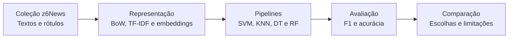

<div align="center">

# 📰 Classificação de Notícias Curtas em Português
### NLP · Machine Learning · Representação de textos

**Como atribuir uma categoria a uma notícia a partir do seu conteúdo?**

Estudo de classificação supervisionada desenvolvido no contexto do **Luppar News-Rec**, comparando representações de documentos e algoritmos de aprendizado de máquina.

[Notebook principal](ClassificacaoNoticiasCurtas_Z6NewsBrasil.ipynb) · [Artigo do projeto](https://medium.com/blog-do-zouza/classifica%C3%A7%C3%A3o-de-not%C3%ADcias-usando-aprendizado-de-m%C3%A1quina-aeeb9b6efe61) · [Resultados](#resultados-registrados) · [Dados](data/)

</div>

---

| **34.327 notícias** | **6 categorias** | **24 combinações** |
| --- | --- | --- |
| Total registrado no notebook. | Temas da coleção z6News. | 6 representações × 4 classificadores. |

## O problema

Organizar notícias por tema ajuda a estruturar acervos, facilitar a busca e alimentar sistemas de recomendação. Em um fluxo de publicação, a classificação automática pode reduzir o trabalho de categorizar cada novo texto manualmente.

O objetivo deste estudo é **aprender com uma coleção já rotulada para atribuir categorias a novas notícias**. O treinamento supervisionado utiliza rótulos existentes; a automação acontece na classificação dos textos após o treinamento.

Este material faz parte da trajetória de pesquisa do **Luppar News-Rec** e permite explorar escolhas de representação, comparação de modelos e avaliação.

## O percurso do estudo



A sequência resume o experimento. Há também um notebook ilustrativo de coleta e pré-processamento, separado do notebook de classificação.

## A coleção z6News

Segundo a descrição do notebook, a coleção reúne notícias curtas coletadas do **G1**. Os arquivos desta pasta contêm os textos preparados e seus rótulos.

| Categoria | Rótulo presente no código |
| --- | --- |
| **Esportes** | `esporteNews` |
| **Política** | `politicaNews` |
| **Tecnologia** | `tecnologiaNews` |
| **Finanças pessoais** | `financaPessoal` |
| **Educação** | `educacaonews` |
| **Ciência, natureza e saúde** | `ciencianaturezasaudenews` |

| Arquivo | Conteúdo |
| --- | --- |
| [`z6News_X.ipy`](data/z6News_X.ipy) | Documentos preparados, utilizados como sequências de tokens. |
| [`z6News_y.ipy`](data/z6News_y.ipy) | Rótulos correspondentes aos documentos. |

Apesar da extensão `.ipy`, os dois arquivos são carregados com **pickle**. A descrição do notebook solicita a referência **Souza (2019)** ao utilizar a coleção; os dados bibliográficos estão ao final desta página.

## Como os textos são representados

O estudo compara representações esparsas e vetores densos.

| Representação | Como resume o documento |
| --- | --- |
| **BoW — Bag of Words** | Contagem dos termos. |
| **TF-IDF** | Pesos baseados na frequência dos termos e em sua presença na coleção. |
| **Word2Vec — média** | Média dos embeddings das palavras conhecidas do documento. |
| **Word2Vec + IDF** | Média dos vetores de palavras multiplicados por seus pesos IDF. |
| **FastText — média** | Média dos vetores obtidos com FastText. |
| **FastText + IDF** | Média dos vetores FastText multiplicados pelos pesos IDF. |

Os embeddings do experimento têm **300 dimensões**, janela **5** e configuração **Skip-gram**.

### A abordagem E2V-IDF

A classe `E2V_IDF` combina a representação das palavras com o **inverso da frequência nos documentos**. A ideia é dar pesos diferentes aos termos conforme sua ocorrência na coleção.

No código, a representação é calculada assim:

```text
Para cada palavra conhecida:
    vetor da palavra × IDF da palavra

Vetor do documento:
    média desses vetores ponderados
```

A implementação divide pelo número de vetores considerados, e não pela soma dos pesos. Se nenhum termo tiver vetor no dicionário, retorna um vetor de zeros.

O FastText pode produzir vetores para palavras fora do vocabulário, mas este notebook o converte em um dicionário de palavras conhecidas. Essa escolha limita o aproveitamento desse recurso no transformador utilizado.

## Classificadores e avaliação

| Classificador | Configuração destacada no notebook |
| --- | --- |
| **SVM com kernel RBF** | `C=1.0`, `gamma=0.01`. |
| **KNN** | 5 vizinhos e distância com `p=2`. |
| **Decision Tree — DT** | `min_samples_split=40`. |
| **Random Forest — RF** | 10 estimadores e `min_samples_split=40`. |

As combinações são organizadas com **Pipeline** e **OneVsRestClassifier**.

O benchmark utiliza **KFold com 10 partições**, embaralhamento e `random_state=66`, com funções para F1 micro e acurácia. O notebook também contém uma etapa posterior com divisão de **80% para treino e 20% para teste** e rótulos binarizados.

## Resultados registrados

Os valores abaixo foram transcritos da compilação existente no notebook. **Não representam uma nova execução ou uma validação independente.**

### Destaques da comparação com validação cruzada

| Combinação | F1 micro registrado |
| --- | ---: |
| **SVM (RBF) + BoW** | **0,806741** |
| **SVM (RBF) + Word2Vec-IDF** | **0,781892** |
| **SVM (RBF) + FastText-IDF** | **0,774696** |
| **SVM (RBF) + TF-IDF** | **0,773152** |

Nesse registro, a representação mais simples, BoW, aparece à frente das alternativas com embeddings. É um ponto de partida para investigar a relação entre representação, características da coleção e classificador.

### Teste posterior com rótulos binarizados

| Combinação | F1 micro | Acurácia registrada |
| --- | ---: | ---: |
| **SVM (RBF) + BoW** | 0,738271 | 0,621177 |
| **SVM (RBF) + Word2Vec-IDF** | 0,760875 | 0,674629 |

Essa etapa usa outra forma de treinamento e avaliação. A acurácia com indicadores binários exige correspondência exata do conjunto de rótulos previsto; os números não devem ser tratados como se fossem a mesma medição da tabela anterior.

<details>
<summary><strong>Como interpretar e reproduzir essas métricas</strong></summary>

<br>

- **Treinamento dos embeddings:** no notebook, Word2Vec e FastText são ajustados sobre a coleção completa antes das divisões. Uma avaliação indutiva de novos textos deve ajustar os componentes aprendidos apenas no treino de cada partição.
- **Partições:** KFold não é estratificado. Considere estratificação, métricas por classe e, para um fluxo real de notícias, validação temporal e por fonte.
- **Rótulos:** o teste posterior usa indicadores binários com OneVsRest, que podem produzir nenhum ou mais de um rótulo. Isso difere da tarefa de escolher exatamente uma categoria.
- **Relatórios por classe:** as chamadas a classification_report estão com os argumentos invertidos em relação à ordem esperada de y_true e y_pred. Recalcule esses relatórios antes de interpretar precisão, recall e suporte.
- **Reprodutibilidade:** os classificadores baseados em árvores não têm random_state definido. Fixe as versões, sementes e partições ao comparar execuções.

Esses pontos não alteram os valores históricos apresentados; definem cuidados para uma nova comparação.

</details>

## Arquivos e caminhos para explorar

| Material | O que você encontra |
| --- | --- |
| [**ClassificacaoNoticiasCurtas_Z6NewsBrasil.ipynb**](ClassificacaoNoticiasCurtas_Z6NewsBrasil.ipynb) | Notebook principal: dados, representações, pipelines e avaliação. |
| [**Live_WebScraping_Exemplo.ipynb**](Live_WebScraping_Exemplo.ipynb) | Demonstração de coleta e pré-processamento; inclui uma fonte diferente da coleção z6News. |
| [**Classificação de Notícias.pdf**](Classifica%C3%A7%C3%A3o%20de%20Not%C3%ADcias.pdf) | Material complementar em PDF. |
| [**Grafos — K-Dijkstra4Doc.ipynb**](Grafos%20-%20K-Dijkstra4Doc.ipynb) | Estudo complementar de documentos com grafos, separado deste benchmark de classificação. |
| [**data/**](data/) | Arquivos da coleção utilizados pelo notebook. |

## Como estudar e executar

### Para conhecer o projeto

Abra o [notebook principal](ClassificacaoNoticiasCurtas_Z6NewsBrasil.ipynb) diretamente no GitHub e acompanhe a definição dos transformadores, as combinações dos modelos e as saídas registradas.

### Para preparar uma execução

1. Baixe ou clone o repositório e mantenha o notebook e a pasta `data/` juntos.
2. Utilize um ambiente Python com Jupyter e as bibliotecas importadas: NumPy, pandas, scikit-learn, Gensim, Matplotlib, seaborn e tabulate.
3. Ajuste os caminhos dos dados: o notebook utiliza `/data/...`, que aponta para a raiz do sistema. Para executar a partir desta pasta, use `data/...`.
4. Confira a compatibilidade das APIs e adapte os pontos necessários antes do treinamento.
5. Comece por uma combinação de representação e classificador; depois avance para o benchmark completo.

**Compatibilidade:** o código usa APIs antigas do Gensim, como `size` e `index2word`. Na API atual, consulte `vector_size` e `index_to_key`. O repositório não fixa um ambiente completo de dependências, portanto instalar versões recentes não garante executar o notebook sem adaptações.

O carregamento abaixo ilustra os caminhos relativos; execute-o a partir da pasta deste projeto, usando os arquivos de origem confiável:

```python
from pathlib import Path
import pickle

pasta = Path("data")

with (pasta / "z6News_X.ipy").open("rb") as arquivo:
    X = pickle.load(arquivo)

with (pasta / "z6News_y.ipy").open("rb") as arquivo:
    y = pickle.load(arquivo)

print(f"Documentos: {len(X)} | Rótulos: {len(y)}")
```

O exemplo de scraping tem dependências próprias, como requests, BeautifulSoup e NLTK. Ele não é necessário para consultar os resultados da coleção já disponibilizada.

## Possibilidades de evolução

- Reexecutar a avaliação com separação estrita entre treino e teste.
- Reportar F1 macro, desempenho por categoria e matriz de confusão.
- Avaliar notícias de outras fontes e períodos.
- Comparar novas representações com os baselines.
- Documentar versões, tempo de treinamento e requisitos de execução.
- Definir o comportamento esperado quando uma notícia não se encaixa bem nas categorias.

## Referências e autoria

- [**Artigo — Classificação de notícias curtas utilizando Aprendizado de Máquina**](https://medium.com/blog-do-zouza/classifica%C3%A7%C3%A3o-de-not%C3%ADcias-usando-aprendizado-de-m%C3%A1quina-aeeb9b6efe61).
- **SOUZA, Antonio Alex de.** *Luppar News-Rec: um recomendador inteligente de notícias.* 2019. 95 f. Dissertação — Mestrado Acadêmico em Computação, Universidade Estadual do Ceará. [Registro da dissertação](http://siduece.uece.br/siduece/trabalhoAcademicoPublico.jsf?id=93501).
- [Word2Vec — Gensim](https://radimrehurek.com/gensim/models/word2vec.html).
- [FastText — Gensim](https://radimrehurek.com/gensim/models/fasttext.html).
- [Pipeline — scikit-learn](https://scikit-learn.org/stable/modules/generated/sklearn.pipeline.Pipeline.html).
- [Métricas e avaliação — scikit-learn](https://scikit-learn.org/stable/modules/model_evaluation.html).

---

**Alex Souza — liderança em dados e professor**

[Portfólio](https://omestredosdados.com.br/portfolio) · [Telegram — Mestre dos Dados](https://t.me/mestredosdados) · [LinkedIn](https://www.linkedin.com/in/alex-souza/) · [Blog](https://medium.com/blog-do-zouza) · [YouTube](https://www.youtube.com/@alexsouzamsc)
