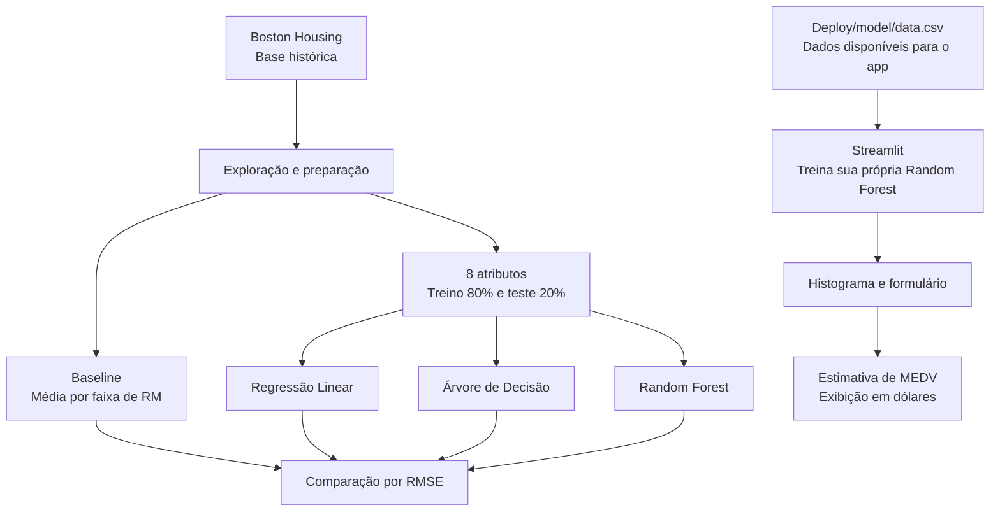

<div align="center">

# 🏡 Previsão de Valores de Imóveis
### Regressão · Comparação de modelos · Streamlit

**Do baseline à aplicação: um estudo de regressão com dados históricos de Boston.**

Exploração dos dados, seleção de atributos e comparação entre **Regressão Linear**, **Árvore de Decisão** e **Random Forest**.

[Notebook](PrevisaoValores_Regressao.ipynb) · [Aplicação](Deploy/app.py) · [Dados do app](Deploy/model/data.csv) · [Resultados](#resultados-registrados) · [Execução](#como-explorar-e-executar)

</div>

---

## O desafio

O cenário didático propõe apoiar uma equipe do setor imobiliário na estimativa de valores a partir de características da região e das habitações.

A análise utiliza a base histórica **Boston Housing**. A variável-alvo, **MEDV**, representa o **valor mediano das habitações ocupadas pelos proprietários em cada área**, expresso em **milhares de dólares** na base original.

Portanto, cada observação não deve ser interpretada como o anúncio ou a transação de um imóvel individual. O estudo demonstra uma abordagem de regressão; suas previsões não representam avaliações imobiliárias atuais.

## O que este projeto demonstra

| Etapa | Aplicação no estudo |
| --- | --- |
| **Referência inicial** | Baseline com médias de MEDV por faixas de RM. |
| **Preparação** | Seleção de oito atributos e transformação de RM para inteiro. |
| **Avaliação** | Separação entre treino e teste e comparação pelo RMSE. |
| **Modelagem** | Regressão Linear, Árvore de Decisão e Random Forest. |
| **Comunicação** | Gráficos comparando valores observados e previstos. |
| **Interface** | Demonstração interativa com Streamlit e Plotly. |

## Fluxo da solução



O aplicativo **não carrega um modelo salvo pelo notebook**: ele treina um novo estimador a partir do CSV ao executar o script.

## Dados e atributos

O notebook registra **506 observações**, inicialmente com **13 atributos preditores**, além do alvo. Após a seleção, utiliza oito entradas:

| Atributo | Significado na base |
| --- | --- |
| **CRIM** | Taxa de criminalidade per capita por município. |
| **INDUS** | Proporção de área destinada a negócios não varejistas por município. |
| **CHAS** | Indicador de limite da área com o rio Charles: 1 para sim, 0 para não. |
| **NOX** | Concentração de óxidos de nitrogênio, em partes por dez milhões. |
| **RM** | Número médio de cômodos por habitação; convertido para inteiro no estudo. |
| **PTRATIO** | Razão entre alunos e professores por município. |
| **B** | Transformação histórica de uma proporção racial: 1000 × (Bk − 0,63)². Não é uma proporção direta. |
| **LSTAT** | Percentual associado à categoria socioeconômica denominada “lower status” na documentação original. |

O alvo **MEDV** fica fora das entradas de treinamento.

### Diferença entre o notebook e o CSV

O arquivo [Deploy/model/data.csv](Deploy/model/data.csv) disponível nesta pasta contém **490 registros e 9 colunas**: oito atributos e MEDV. As saídas do notebook, por sua vez, descrevem 506 registros.

Essa diferença precisa ser conciliada para reproduzir a mesma população de dados nas duas etapas. Não há, no fluxo exibido, uma explicação explícita para essa redução.

### Contexto da base histórica

A Boston Housing contém variáveis e pressupostos problemáticos, especialmente o atributo B, e foi retirada da API atual do scikit-learn. A [documentação histórica de load_boston](https://scikit-learn.org/1.1/modules/generated/sklearn.datasets.load_boston.html) explica essa decisão.

O material deve ser lido com esse contexto. Para desenvolver uma nova solução, escolha uma base adequada ao problema e revise a pertinência das variáveis, a representatividade e os efeitos do modelo.

## Baseline: começar por uma referência simples

O baseline calcula a média de MEDV em três faixas do atributo RM, após sua conversão para inteiro:

| Faixa de RM | Categoria do exemplo | Média registrada de MEDV |
| --- | --- | ---: |
| **Até 4** | Pequeno | 17,260 |
| **5 ou 6** | Médio | 20,340 |
| **7 ou mais** | Grande | 38,397 |

As médias estão em **milhares de dólares**. As categorias são uma simplificação didática de RM, não uma classificação imobiliária validada.

**Ponto para uma nova avaliação:** as médias do baseline são calculadas com a base completa antes da divisão entre treino e teste. Recalcule-as apenas no treino para evitar que os valores-alvo do teste influenciem essa referência.

## Resultados registrados

O notebook utiliza uma divisão **80% / 20%**, com `random_state=5`: **404 registros de treino e 102 de teste**.

| Abordagem | RMSE salvo no notebook |
| --- | ---: |
| **Baseline por faixa de RM** | 6,327 |
| **Regressão Linear** | 5,139 |
| **Árvore de Decisão** | 4,535 |
| **Random Forest** | **3,695** |

**Quanto menor o RMSE, menor o erro quadrático médio na escala do alvo.** Como MEDV está em milhares de dólares, um RMSE de 3,695 equivale a aproximadamente US$ 3.695 nessa escala histórica. Isso não significa erro fixo, margem garantida ou intervalo de confiança para cada previsão.

A Random Forest apresenta o menor RMSE entre as saídas registradas. Esses resultados são **históricos e não foram recalculados nesta revisão**; a comparação com o baseline exige o cuidado metodológico descrito acima.

A árvore e a floresta não têm semente definida no notebook, e não há validação cruzada no fluxo apresentado. Uma nova execução pode produzir valores diferentes.

## Demonstração com Streamlit

A aplicação [Deploy/app.py](Deploy/app.py) permite:

- Explorar um **histograma de MEDV**, com filtro por faixa.
- Informar os **oito atributos** na barra lateral.
- Solicitar uma estimativa e visualizar a saída multiplicada por 1.000, em dólares.

A Random Forest do aplicativo utiliza:

```python
RandomForestRegressor(
    n_estimators=200,
    max_depth=7,
    max_features=3
)
```

Essa configuração difere da floresta avaliada no notebook, que registra 100 árvores e parâmetros padrão da época. O app treina com todo o CSV e não calcula uma métrica de teste própria; **o RMSE do notebook não valida automaticamente o modelo da interface**.

## Arquivos do projeto

| Arquivo | Conteúdo |
| --- | --- |
| [**PrevisaoValores_Regressao.ipynb**](PrevisaoValores_Regressao.ipynb) | Raciocínio da análise, baseline, modelos, métricas e exportação. |
| [**Deploy/app.py**](Deploy/app.py) | Interface Streamlit e treinamento do modelo do app. |
| [**Deploy/model/data.csv**](Deploy/model/data.csv) | Dados usados pela aplicação. |
| [**Deploy/log_instalacao.txt**](Deploy/log_instalacao.txt) | Registro histórico de instalação; não substitui um arquivo de dependências. |

## Como explorar e executar

### 1. Leia o experimento

Abra o [notebook no GitHub](PrevisaoValores_Regressao.ipynb) para acompanhar a análise e os gráficos salvos.

Para reexecutá-lo em um ambiente atual, revise estes pontos:

| Trecho histórico | Ajuste necessário ou recomendado |
| --- | --- |
| **load_boston()** | A função foi removida do scikit-learn atual. Planeje a fonte de dados e o contexto da reprodução; o CSV do app é um recorte diferente. |
| **Google Colab / Drive** | Adapte ou remova a montagem do Drive ao executar localmente. |
| **Series.iteritems()** | Substitua por `Series.items()` em versões atuais do pandas. |
| **Médias por categoria** | Use acesso explícito pelos nomes das categorias e calcule as médias apenas no treino. |
| **RM convertido para inteiro** | Avalie a perda de informação: a variável original é uma média de cômodos. |
| **Sementes e versões** | Registre o ambiente e defina sementes nos estimadores. |

### 2. Prepare a demonstração local

A aplicação lê o CSV incluído e **não depende de load_boston()**.

Com Python e um ambiente virtual preparado, instale as dependências diretas:

```bash
python -m pip install pandas streamlit plotly scikit-learn
```

Não há versões fixadas nesta pasta. Antes de iniciar com Streamlit atual, revise o uso antigo de `@st.cache`: para o carregamento do CSV, considere `@st.cache_data`.

Confira também o formulário:

- **INDUS** recebe por engano a média de CRIM como valor inicial; alinhe-o com o atributo correto.
- **RM** é exibido como “Número de Quartos”, mas representa média de cômodos por habitação na fonte.
- **B** é apresentado como proporção direta, embora seja uma transformação dessa proporção.
- Valide faixas, unidades e tipos e preserve a ordem das oito entradas do treino.

Esses pontos estão documentados aqui; o código original não foi alterado nesta revisão.

### 3. Inicie o aplicativo

A partir da pasta deste projeto:

```bash
cd Deploy
streamlit run app.py
```

Abra o endereço informado no terminal. Executar dentro de `Deploy` preserva o caminho relativo `model/data.csv` esperado pelo código.

A execução completa da aplicação não foi validada nesta revisão. A interface é uma demonstração local, sem avaliação imobiliária atual ou implantação operacional comprovada.

## Possibilidades de evolução

- Utilizar uma base contemporânea, com unidade de observação e objetivo bem definidos.
- Conciliar os dados do notebook com os dados da aplicação.
- Reavaliar atributos sensíveis, proxies e pertinência das entradas.
- Comparar modelos com validação cruzada e teste final preservado.
- Analisar resíduos, MAE e erros por faixa de valor, além do RMSE.
- Ajustar hiperparâmetros no conjunto de treino e registrar os experimentos.
- Persistir o modelo avaliado e reutilizá-lo na interface, evitando treinar a cada execução.
- Fixar dependências e revisar os rótulos e validações do formulário.

## Referências e créditos

- [**Boston Housing — documentação histórica e contexto da remoção**](https://scikit-learn.org/1.1/modules/generated/sklearn.datasets.load_boston.html).
- [**RandomForestRegressor — scikit-learn**](https://scikit-learn.org/stable/modules/generated/sklearn.ensemble.RandomForestRegressor.html).
- [**Avaliação de modelos — scikit-learn**](https://scikit-learn.org/stable/modules/model_evaluation.html).
- [**Streamlit — documentação oficial**](https://docs.streamlit.io/).
- [**Visualização de dados — materiais de Alex Souza**](https://omestredosdados.com.br/visualizacao-de-dados.html).

O notebook credita a **Semana de Data Science do canal Minerando Dados** como referência para a construção do material.

---

**Alex Souza — liderança em dados e professor**

[Portfólio](https://omestredosdados.com.br/portfolio) · [Telegram — Mestre dos Dados](https://t.me/mestredosdados) · [O Mestre dos Dados](https://omestredosdados.com.br/)

[← Voltar ao portfólio no GitHub](../README.md)
